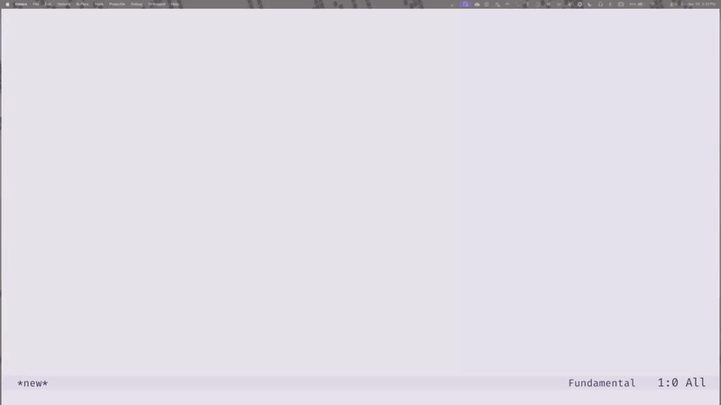

#+TITLE: El Remoto

#+HTML: 

[[https://github.com/agzam/remoto.el/actions/workflows/run-tests.yml][https://github.com/agzam/remoto.el/actions/workflows/run-tests.yml/badge.svg]]

#+begin_quote
El Remoto - browse any GitHub or Codeberg repository in Emacs just like any local - no cloning.
#+end_quote

* What
Wouldn't it be nice to be able to ~C-x C-f~ and just browse any remote repo?

It registers a virtual filesystem via ~file-name-handler-alist~ that translates standard file operations into calls to remote API. ~find-file~, ~dired~, tab-completion, ~dired-subtree~ - etc. seamlessly work against a remote repository.

First time it was [[https://youtu.be/YV1kyVE6SvU][demoed]] at [[https://www.meetup.com/emacsatx/][Emacs ATX Meetup]] of July 2026.

* Why

Sometimes you just want to look at code. Check a function signature, glance over the README, browse the project structure. Cloning is overkill for that - it takes disk space, makes you think about where to put the damn folder; generally, it just breaks your flow.

* Where

It is on [[https://melpa.org/#/remoto][MELPA]]. 

* How

#+begin_src emacs-lisp
(use-package remoto)
#+end_src

Loading the package defines things and changes nothing. ~global-remoto-mode~ is the switch: it installs the file handler, the URL rewriting in ~find-file~ and ~dired~, completion metadata; and when turned off - removes them all.

The mode turns itself on at first use, whichever way that comes: ~M-x remoto-browse~, an Embark open action, or a ~/github:~ or ~/codeberg:~ path typed at ~C-x C-f~, ~C-x d~ or any other file prompt. For the last one the package autoloads register a small handler for those prefixes, hands over to the real handler and steps aside. Each of these says so once in the echo area. To skip that message, add ~(global-remoto-mode 1)~ in the config.

#+HTML: 

** GitHub
#+HTML: 

*** Auth

Public repositories need no setup. A token adds private repositories, a higher rate limit (5,000 requests an hour instead of 60), and ~/gh:~ itself, which lists your account and organizations.

Either manually add your GH token to ~auth-sources~, such as =~/.authinfo.gpg= in the form of:

#+begin_example
machine github.com login USER password TOKEN
#+end_example

Or Run ~M-x remoto-login~ and follow the instructions. 

*** Usage Examples

#+begin_example
C-x C-f /gh:torvalds/linux RET           -> the tree on the default branch
C-x C-f /gh:torvalds/linux@ TAB          -> branches, then tags
C-x C-f /gh:agzam/remoto.el#37 RET       -> a pull request
C-x d   /gh:torvalds/ RET                -> the repositories of an account
C-x C-f https://github.com/torvalds/linux/blob/master/README RET
#+end_example

~/gh:~ is short for ~/github:~ and works wherever the long form does.

~M-x remoto-browse~ prompts for a repository and opens its Dired. It takes any form GitHub hands out:

#+begin_src emacs-lisp
M-x remoto-browse RET https://github.com/torvalds/linux RET
M-x remoto-browse RET git@github.com:torvalds/linux.git RET
M-x remoto-browse RET torvalds/linux RET
#+end_src

#+HTML: 

#+HTML: 

** Codeberg
#+HTML: 

*** Auth

Public repositories need no setup. A token adds private repositories and ~/cb:~ itself, which lists your account and organizations.

Either manually add your Codeberg token to ~auth-sources~, such as =~/.authinfo.gpg= in the form of:

#+begin_example
machine codeberg.org login USER password TOKEN
#+end_example

Or Run ~M-x remoto-login~, pick Codeberg, and follow the instructions. 

*** Usage Examples

#+begin_example
C-x C-f /cb:forgejo/forgejo RET          -> the tree on the default branch
C-x C-f /cb:forgejo/forgejo@ TAB         -> branches, then tags
C-x C-f /cb:forgejo/forgejo#14933 RET    -> a pull request, with its reviews
C-x d   /cb:forgejo/ RET                 -> the repositories of an account
C-x C-f https://codeberg.org/forgejo/forgejo/src/branch/forgejo/go.mod RET
#+end_example

~/cb:~ is short for ~/codeberg:~.

*** Other Forgejo and Gitea servers

Other Forgejo or Gitea servers get a prefix each through ~remoto-forgejo-instances~, a list of ~(PREFIX HOST)~ pairs. A prefix that names a TRAMP method, such as ~ssh~, is refused, since it would take those paths from TRAMP.

#+begin_src emacs-lisp
(setopt remoto-forgejo-instances '(("gitea" "gitea.com")))
;; C-x C-f /gitea:gitea/tea RET
#+end_src

Auth works as on Codeberg: ~M-x remoto-login~ names each server by its host, and a row of your own goes under ~HOST~.

#+HTML: 

#+HTML: 

** Gists
#+HTML: 

*** Auth

Public gists need no setup. ~/gist:~ itself, which lists your gists and the ones you starred, needs your GitHub token: the same ~machine github.com~ row, or ~M-x remoto-login~. Your secret gists, and saving to any of your gists, also need the ~gist~ scope on that token.

*** Usage Examples

#+begin_example
C-x C-f /gist: TAB                      -> your gists, then the ones you starred
C-x C-f /gist:agzam/ TAB                -> the gists of an account, by description
C-x C-f /gist:agzam/197a63b37ce827bb95761069ffc85b3c RET -> a gist of one file opens at its file
C-x d   /gist:agzam/1b484c2fcb109d19e2964da7282442b7 RET -> the files of a gist
C-x C-f https://gist.github.com/agzam/197a63b37ce827bb95761069ffc85b3c RET
#+end_example

A gist's files are at ~/gist:OWNER/ID:/FILE~. Dired and completion keep the id out of sight: a gist shows its description and its file names, and a candidate says whether the gist is secret or public - an octicon when [[https://github.com/rainstormstudio/nerd-icons.el][nerd-icons]] is loaded.

~M-x remoto-browse~ takes a gist's page URL, raw URL and clone URLs. The copy and browse commands give a gist's page, raw, revisions and clone URLs, and a permalink at its latest revision.

A gist opens at its latest revision; revisions, comments and search stay on the website.

*** Editing your gists

The files of your own gists open writable; the gists of other accounts, starred ones included, stay read-only. ~C-x C-s~ (or ~:w~) saves the file to GitHub. The echo area says "(public gist)" after a save to a public gist: each of its saves is a public revision.

If the file changed on GitHub since you opened it, remoto asks before the save goes over it: overwrite, see the diff, or quit. ~M-x remoto-diff-buffer-with-file~ shows the buffer against the text GitHub holds now, and in remoto buffers a key bound to ~diff-buffer-with-file~ runs it. ~revert-buffer~ reads the file from GitHub anew.

~C-x C-f~ a new name in your gist and the first save adds the file; ~C-x C-w~ writes any buffer into a gist. Dired's ~C~ copies files in, from a local directory or any repository, ~R~ and ~C-x x r~ rename, and ~D~ deletes a file, which stays in the gist's revisions. wdired edits the names in a gist's Dired. A rename to another gist, or to or from a local directory, is a copy and a deletion.

A gist keeps UTF-8 text only: a binary file stays read-only, and a buffer in another coding system asks for ~C-x RET f utf-8~ first. A gist is flat and holds no blank file, since GitHub would delete it: a name with a slash, a directory and an empty file are refused. GitHub keeps the last file of a gist.

#+HTML: 

** Features

*** find-file completion

Every prefix enables multi-level completion directly in ~find-file~ (~C-x C-f~). Three delimiters after ~owner/repo~ control the mode: ~/~ for files, ~@~ for branches/tags, ~#~ for issues/PRs.

#+begin_example
/gh:                       -> your user + orgs (when authenticated)
/gh:tor                    -> users/orgs matching "tor"
/gh:torvalds/              -> repos (with descriptions)
/gh:torvalds/linux/        -> files on default branch (with last commit messages)
/gh:torvalds/linux@        -> branches + tags (grouped)
/gh:torvalds/linux@master: -> file-level completion
/gh:torvalds/linux#        -> issues + PRs
#+end_example

*** Issue/PR display

Opening ~/github:owner/repo#42~ shows a dedicated buffer with the issue or PR content. For PRs: diff stats, branch info, merge status, and review summary. For both: body + comments.

Keybindings in the display buffer: ~b~ (open in browser), ~g~ (refresh).

*** Language servers

LSP makes no sense on a remote Git path, so remoto keeps lsp-mode and Eglot out of its buffers. To keep other tools out too, add them to ~remoto-inhibited-functions~:

#+begin_src emacs-lisp
(setopt remoto-inhibited-functions '(lsp eglot-ensure flycheck-mode))
#+end_src

*** Evil

Evil's ex commands take remoto paths: ~:e~, ~:sp~, ~:vs~, ~:view~ and ~:new~ open them as ~C-x C-f~ does.

#+begin_example
:e /gh:torvalds/linux/README
:e /github:torvalds/linux@master:/Makefile
:e /gh:agzam/remoto.el#37
#+end_example

In a name that starts with ~/gh:~ or ~/github:~, ~#~ and ~%~ are literal: they do not name Evil's alternate and current file. A relative name keeps Evil's meaning, so in a remoto Dired, ~:e C\#/Program.cs~ opens ~C#/Program.cs~.

*** project.el

A remoto repository is a project: ~C-x p f~, ~C-x p d~, ~C-x p D~, ~C-x p b~, ~C-x p k~ and ~C-x p p~ - just work.

Commands that require local items obviously wouldn't - ~project-shell~, ~project-compile~, ~project-find-regexp~, ~consult-ripgrep~.

With ~C-x p R~ (~remoto-project-find-file~) browse project's remote; with ~C-u~ you get to pick which one.

*** Embark

Optional [[https://github.com/oantolin/embark][Embark]] integration, which is not a hard dependency; when it is installed it activates automatically. Then, ~embark-act~ offers forge-agnostic actions on remoto targets everywhere - ~dired~, minibuffer completion, ~embark-collect~ buffer.

Each target type has its own keymap of actions. Run ~embark-act~ on a target to see its actions and keys. Cloning honors ~remoto-clone-url-type~ and opens the clone's Magit status buffer when it finishes. Embark's built-in ~url~ target gains ~R~ to open a forge URL at point.

** How does it all work

1. On first access to any file in a repo, the full directory tree is fetched via the Git Trees API (one HTTP call).
2. Directory listings, ~file-exists-p~, completions - all served from the cached tree in memory.
3. File contents are fetched on demand when you actually open a file.
4. Content is cached by SHA, so re-opening the same file is instant.
5. Requests go through ~ghub~, with a token from auth-source when one is set up (see Auth under each forge).
6. The core asks a forge for its data through a small set of generic functions; GitHub answers them in ~remoto-github.el~, and ~remoto-forgejo.el~ reuses those answers for Forgejo and Gitea servers, Codeberg among them; ~remoto-gist.el~ answers them for gists. Support for other forges, such as GitLab, builds on that.

** FAQ
*** Why this isn't a [[https://www.gnu.org/software/emacs/manual/html_node/tramp/][TRAMP]] backend?
- TRAMP fundamentally is a shell-over-transport abstraction. Every TRAMP backend assumes a remote shell on the other end, remoto.el has no remote shell.
- TRAMP's backend API is large. You'd need to implement or stub dozens of operations, many of which assume concepts that don't map to a REST API (process execution, file ownership, symlink resolution, timestamps).
- TRAMP's connection management (open/close/reuse) is built around persistent sessions. The GitHub API is stateless HTTP - there's no connection to manage.
- TRAMP's caching layer is path-based and per-connection. remoto's tree cache (one API call fetches the entire repo tree, then everything is served from memory) is a fundamentally different - and much more efficient - model for a read-only tree-structured API.
- =file-name-handler-alist= IS the same mechanism TRAMP uses. Registering there directly gives you the same integration (dired, find-file, completions) without the framework overhead.
  
For a read-only tree browser backed by a REST API, a direct file-name-handler is the simpler, more natural fit

*** Why not just use plain HTTP?

Git's own protocols let you talk to a remote repo without cloning it, so why not use that, right?

- Tree listing. There's no raw HTTP URL that gives you a directory listing. raw.githubblabla.com can't do directory indexes. You'd have to shell out to =git ls-tree ... etc.= over the ssh, which means essentially implementing a partial git client.

- Branch listing and repo search - no git protocol equivalent for those - need the API

- Current approach fetches the entire tree in one API call. Doing the same over git pack protocol means negotiating a fetch, receiving packfile data and parsing it. Much heavier, much more code.

We can only imagine a world where git's transport layer gives you a browsable filesystem interface. It doesn't - git's protocols are optimized for syncing object graphs, not random-access file browsing.

** Limitations

- Repositories are read-only: no commits, no pushes, no file modifications. You still can copy files out. The files of your own gists are the exception (see Gists).
- No git operations (log, blame, diff).
- No programs run against a repository: grep, ripgrep, compile and ~project-find-regexp~ need a clone. In-buffer search (isearch, occur) works on opened files.
- Timestamps in a repository's Dired are synthetic (the tree API has no timestamps); a listing of repositories shows their last push.
- Very large repos (100k+ files) use slower per-directory fetching.
- Rate limits: GitHub allows 5,000 requests an hour with a token and 60 without; Codeberg allows 2,000 per 10 minutes. Normal browsing stays well within them, though not within GitHub's 60.
- Per-file commit annotations make up to 20 API calls on first directory listing (cached after).
- Forgejo serves a repository's tree 1,000 entries a page; a large repository takes a few seconds to open the first time, and one with more than 20,000 files falls back to per-directory fetching.

* Changelog

See [[file:changelog.org][changelog.org]] for a detailed list of changes and version history.

* License
Copyright © 2026 Ag Ibragimov

GPL-3.0-or-later. See [[file:LICENSE][LICENSE]].
