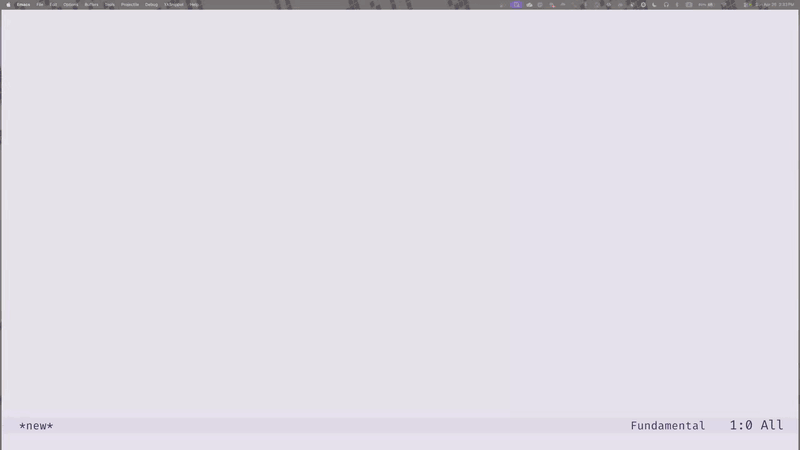

#+TITLE: El Remoto

#+HTML: 

[[https://github.com/agzam/remoto.el/actions/workflows/run-tests.yml][https://github.com/agzam/remoto.el/actions/workflows/run-tests.yml/badge.svg]]

#+begin_quote
El Remoto - browse any GitHub or Codeberg repository in Emacs just like any local - without cloning.
#+end_quote

* What
Wouldn't it be nice to be able to ~C-x C-f~ and just browse any GitHub repo?

remoto.el registers a virtual filesystem via ~file-name-handler-alist~ that translates standard Emacs file operations into calls to the forge's API via the ~ghub~ library. The result: ~find-file~, ~dired~, tab-completion, ~dired-subtree~ - all standard Emacs file tooling works against a remote repository. Read-only.

It was demoed at [[https://www.meetup.com/emacsatx/][Emacs ATX Meetup]] of July 2026. Here's the [[https://youtu.be/YV1kyVE6SvU][video]]. Link to the complete video of that meetup (~2 hrs) is in the description.

* Why

Sometimes you just want to look at code. Check a function signature, read a README, browse a project structure. Cloning a repo for that is overkill - it takes disk space, creates another directory to manage, and breaks your flow.

* Where

GitHub, under ~/github:~ and ~/gh:~, and Codeberg, under ~/codeberg:~ and ~/cb:~.

* How
** use-package 

Loading the package defines things and changes nothing. ~global-remoto-mode~ is the switch: it installs the file handler, the URL rewriting in ~find-file~ and ~dired~, and the completion metadata, and removes them all when turned off. Nothing else is needed:

It is on [[https://melpa.org/#/remoto][MELPA]]. You can just point at it and Emacs will fetch it (if MELPA is in the ~package-archives~) 
#+begin_src emacs-lisp
(use-package remoto)
#+end_src

The mode turns itself on at first use, whichever way that comes: ~M-x remoto-browse~, an Embark open action, or a ~/github:~, ~/gh:~, ~/codeberg:~ or ~/cb:~ path typed at ~C-x C-f~, ~C-x d~ or any other file prompt. For the last one the package autoloads register a small handler for those prefixes, the way TRAMP loads on the first remote path; it hands over to the real handler and steps aside. Each of these says so once in the echo area. To have the mode on from the start, and skip that message, put ~(global-remoto-mode 1)~ in your config.

#+HTML: 

** GitHub
#+HTML: 

*** Auth

Public repositories need no setup. A token adds private repositories, a higher rate limit (5,000 requests an hour instead of 60), and ~/gh:~ itself, which lists your account and organizations.

Run ~M-x remoto-login~. It opens GitHub's page for a new token with its scopes ticked, reads the token you paste, checks it with GitHub, and stores it in the first =.gpg= file of ~auth-sources~, such as =~/.authinfo.gpg=; without one, or when GnuPG cannot write it, the token lasts the session. A new =.gpg= file asks for a passphrase twice, as auth-source does. The page's address also goes to =*Messages*=, for an Emacs with no browser at hand. There is no command to remember: when GitHub's limit runs out, or when you open ~/gh:~, remoto asks to log in.

The page ticks ~repo~, for private repositories, and ~read:org~, to list your organizations. A fine-grained token works for the repositories it covers, but GitHub lists no organizations for it.

remoto also reads the tokens you keep already, with no git config: those of [[https://github.com/magit/ghub][ghub]] and [[https://github.com/magit/forge][Forge]] (the login ~USER^ghub~ or ~USER^forge~ under ~api.github.com~), or a row of your own:

#+begin_example
machine github.com login USER password TOKEN
#+end_example

When GitHub refuses a token, remoto takes the next one auth-source holds before it asks you to log in again. It reads a macOS keychain only when no other source holds a token, since macOS asks before remoto reads an item that git's credential helper saved. After you change auth-source by hand in a running Emacs, ~M-x remoto-reset-auth~ looks the token up again. To send no token at all, set ~remoto-github-auth~ to ~none~.

*** Examples

#+begin_example
C-x C-f /gh:torvalds/linux RET           -> the tree on the default branch
C-x C-f /gh:torvalds/linux@ TAB          -> branches, then tags
C-x C-f /gh:agzam/remoto.el#37 RET       -> a pull request
C-x d   /gh:torvalds/ RET                -> the repositories of an account
C-x C-f https://github.com/torvalds/linux/blob/master/README RET
#+end_example

~/gh:~ is short for ~/github:~ and works wherever the long form does.

~M-x remoto-browse~ prompts for a repository and opens its Dired. It takes any form GitHub hands out:

#+begin_src emacs-lisp
M-x remoto-browse RET https://github.com/torvalds/linux RET
M-x remoto-browse RET git@github.com:torvalds/linux.git RET
M-x remoto-browse RET torvalds/linux RET
#+end_src

It reads GitHub names only; a Codeberg URL or a ~/cb:~ path opens with ~C-x C-f~.
#+HTML: 

#+HTML: 

** Codeberg
#+HTML: 

*** Auth

Public repositories need no setup. A token adds private repositories and ~/cb:~ itself, which lists your account and organizations.

Run ~M-x remoto-login~ and pick Codeberg. It opens Codeberg's page of applications, where you generate a token with Read on repository, issue, organization and user, and access to All repositories; Specific repositories cannot hold the user and organization permissions. remoto checks the token and stores it as it does GitHub's.

A token you keep for Forge works as it is, and so does a row of your own:

#+begin_example
machine codeberg.org login USER password TOKEN
#+end_example

*** Examples

#+begin_example
C-x C-f /cb:forgejo/forgejo RET          -> the tree on the default branch
C-x C-f /cb:forgejo/forgejo@ TAB         -> branches, then tags
C-x C-f /cb:forgejo/forgejo#14933 RET    -> a pull request, with its reviews
C-x d   /cb:forgejo/ RET                 -> the repositories of an account
C-x C-f https://codeberg.org/forgejo/forgejo/src/branch/forgejo/go.mod RET
#+end_example

~/cb:~ is short for ~/codeberg:~.

*** Other Forgejo and Gitea servers

Other Forgejo or Gitea servers get a prefix each through ~remoto-forgejo-instances~, a list of ~(PREFIX HOST)~ pairs. A prefix that names a TRAMP method, such as ~ssh~, is refused, since it would take those paths from TRAMP.

#+begin_src emacs-lisp
(setopt remoto-forgejo-instances '(("gitea" "gitea.com")))
;; C-x C-f /gitea:gitea/tea RET
#+end_src

Auth works as on Codeberg: ~M-x remoto-login~ names each server by its host, and a row of your own goes under ~HOST~.

The built-in prefixes load remoto on their first use; a prefix from this option exists once remoto is loaded, so turn ~global-remoto-mode~ on in your config to type it at the first prompt of a session.
#+HTML: 

** Usage

*** find-file completion

Every prefix enables multi-level completion directly in ~find-file~ (~C-x C-f~). Three delimiters after ~owner/repo~ control the mode: ~/~ for files, ~@~ for branches/tags, ~#~ for issues/PRs.

#+begin_example
/github:              -> your user + orgs (when authenticated)
/github:tor           -> users/orgs matching "tor"
/github:torvalds/     -> repos (with descriptions)
/github:torvalds/linux/        -> files on default branch (with last commit messages)
/github:torvalds/linux@        -> branches + tags (grouped)
/github:torvalds/linux@master: -> file-level completion
/github:torvalds/linux#        -> issues + PRs
#+end_example

Each level shows annotations: repo descriptions, issue/PR titles and state, file commit messages, user/org type. Works with vanilla completion, Vertico, Corfu, etc. While a request is in flight, a ~⟳~ sits between the prompt and the path being typed, and once the path is chosen and opens, the same mark sits in the echo area; ~remoto-browse~ shows the same two, and ~remoto-show-fetch-indicator~ turns both off.

Hitting RET on ~/github:owner/repo~ opens the default branch. ~/github:owner/repo#42~ opens an issue/PR display buffer.

*** Canonical paths

The virtual filesystem uses paths of the form:

#+begin_example
/github:OWNER/REPO@REF:/PATH
#+end_example

~REF~ is optional - omitting it uses the repo's default branch.

*** Issue/PR display

Opening ~/github:owner/repo#42~ shows a dedicated buffer with the issue or PR content. For PRs: diff stats, branch info, merge status, and review summary. For both: body + comments.

Keybindings in the display buffer: ~b~ (open in browser), ~g~ (refresh).

*** Commands

| Command              | Description                                                   |
|----------------------+---------------------------------------------------------------|
| ~global-remoto-mode~ | Turn the file handler, URL rewriting and completion on or off |
| ~remoto-browse~      | Prompt for a GitHub repo, open dired at root                  |
| ~remoto-refresh~     | Clear the cache of the current repo or listing, re-fetch      |
| ~remoto-copy-url~    | Copy the forge URL for current file/line to kill ring         |
| ~remoto-login~       | Log in to a forge with a token, and store the token           |
| ~remoto-reset-auth~  | Forget the login state, look the token up again               |

*** Language servers

LSP makes no sense on a remote Git path, so remoto keeps lsp-mode and Eglot out of its buffers. To keep other tools out too, add them to ~remoto-inhibited-functions~:

#+begin_src emacs-lisp
(setopt remoto-inhibited-functions '(lsp eglot-ensure flycheck-mode))
#+end_src

*** Evil

Evil's ex commands take remoto paths: ~:e~, ~:sp~, ~:vs~, ~:view~ and ~:new~ open them as ~C-x C-f~ does.

#+begin_example
:e /gh:torvalds/linux/README
:e /github:torvalds/linux@master:/Makefile
:e /gh:agzam/remoto.el#37
#+end_example

In a name that starts with ~/gh:~ or ~/github:~, ~#~ and ~%~ are literal: they do not name Evil's alternate and current file. A relative name keeps Evil's meaning, so in a remoto Dired, ~:e C\#/Program.cs~ opens ~C#/Program.cs~.

** Embark integration

Optional [[https://github.com/oantolin/embark][Embark]] integration lives in ~remoto-embark.el~. Embark is not a hard dependency; when it is installed the integration activates automatically, with nothing to configure. With it active, ~embark-act~ offers forge-agnostic actions on remoto targets in remoto file buffers, ~dired~, and ~/github:~ minibuffer completion (including ~embark-collect~).

Each target type has its own keymap of actions that reuse remoto's forge-agnostic URL layer (copy or browse the web URL, clone, blame, permalink, open an issue/PR, and so on):

| Target        | Example                               | Keymap                   |
|---------------+---------------------------------------+--------------------------|
| ~remoto-owner~  | ~/github:torvalds~                      | ~remoto-embark-owner-map~  |
| ~remoto-repo~   | ~/github:torvalds/linux:/~              | ~remoto-embark-repo-map~   |
| ~remoto-branch~ | ~/github:torvalds/linux@master:/~       | ~remoto-embark-branch-map~ |
| ~remoto-issue~  | ~/github:torvalds/linux#42~             | ~remoto-embark-issue-map~  |
| ~remoto-dir~    | ~/github:torvalds/linux@master:/fs~     | ~remoto-embark-dir-map~    |
| ~remoto-file~   | ~/github:torvalds/linux@master:/README~ | ~remoto-embark-file-map~   |

A branch or tag offers the repository's actions as well. Run ~embark-act~ on a target to see its actions and keys. Cloning honors ~remoto-clone-url-type~ and opens the clone's Magit status buffer when it finishes (~dired~ without Magit), and Embark's built-in ~url~ target gains ~R~ to open a forge URL at point as a remoto path.

** How does it work

1. On first access to any file in a repo, the full directory tree is fetched via the Git Trees API (one HTTP call).
2. Directory listings, ~file-exists-p~, completions - all served from the cached tree in memory.
3. File contents are fetched on demand when you actually open a file.
4. Content is cached by SHA, so re-opening the same file is instant.
5. Requests go through ~ghub~, with a token from auth-source when one is set up (see Auth under each forge).
6. The core asks a forge for its data through a small set of generic functions; GitHub answers them in ~remoto-github.el~, and ~remoto-forgejo.el~ reuses those answers for Forgejo and Gitea servers, Codeberg among them. Support for other forges - gists, GitLab - builds on that.

** FAQ
*** Why this isn't a [[https://www.gnu.org/software/emacs/manual/html_node/tramp/][TRAMP]] backend?
- TRAMP fundamentally is a shell-over-transport abstraction. Every TRAMP backend assumes a remote shell on the other end, remoto.el has no remote shell.
- TRAMP's backend API is large. You'd need to implement or stub dozens of operations, many of which assume concepts that don't map to a REST API (process execution, file ownership, symlink resolution, timestamps).
- TRAMP's connection management (open/close/reuse) is built around persistent sessions. The GitHub API is stateless HTTP - there's no connection to manage.
- TRAMP's caching layer is path-based and per-connection. remoto's tree cache (one API call fetches the entire repo tree, then everything is served from memory) is a fundamentally different - and much more efficient - model for a read-only tree-structured API.
- =file-name-handler-alist= IS the same mechanism TRAMP uses. Registering there directly gives you the same integration (dired, find-file, completions) without the framework overhead.
  
For a read-only tree browser backed by a REST API, a direct file-name-handler is the simpler, more natural fit

*** Why not just use plain HTTP?

Git's own protocols let you talk to a remote repo without cloning it, so why not use that, right?

- Tree listing. There's no raw HTTP URL that gives you a directory listing. raw.githubblabla.com can't do directory indexes. You'd have to shell out to =git ls-tree ... etc.= over the ssh, which means essentially implementing a partial git client.

- Branch listing and repo search - no git protocol equivalent for those - need the API

- Current approach fetches the entire tree in one API call. Doing the same over git pack protocol means negotiating a fetch, receiving packfile data and parsing it. Much heavier, much more code.

We can only imagine a world where git's transport layer gives you a browsable filesystem interface. It doesn't - git's protocols are optimized for syncing object graphs, not random-access file browsing.

** Limitations

- Read-only. No commits, no pushes, no file modifications. You still can copy them out.
- No git operations (log, blame, diff).
- Timestamps in a repository's Dired are synthetic (the tree API has no timestamps); a listing of repositories shows their last push.
- Very large repos (100k+ files) use slower per-directory fetching.
- Rate limits: GitHub allows 5,000 requests an hour with a token and 60 without; Codeberg allows 2,000 per 10 minutes. Normal browsing stays well within them, though not within GitHub's 60.
- Per-file commit annotations make up to 20 API calls on first directory listing (cached after).
- Forgejo serves a repository's tree 1,000 entries a page; a large repository takes a few seconds to open the first time, and one with more than 20,000 files falls back to per-directory fetching.

* Changelog

See [[file:changelog.org][changelog.org]] for a detailed list of changes and version history.

* License
Copyright © 2026 Ag Ibragimov

GPL-3.0-or-later. See [[file:LICENSE][LICENSE]].
